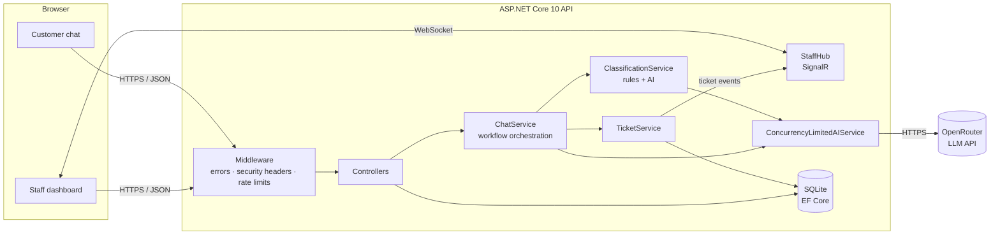

# Telegroup Customer Service Chatbot

[](https://github.com/irrisdev/AP-Master/actions/workflows/ci.yml)

An AI-enabled customer service chatbot for **Telegroup Limited**, a fictional UK telecommunications
provider of broadband, Wi-Fi, home phone lines and the equipment for them.

Customers chat in plain English. The system works out what they need and handles it:

| Request                                               | What happens                                                                                                                                                                              |
| ----------------------------------------------------- | ----------------------------------------------------------------------------------------------------------------------------------------------------------------------------------------- |
| **Enquiry**, e.g. "what packages do you offer?"       | The AI answers in context, using the conversation so far.                                                                                                                                 |
| **Technical support**, e.g. "my router won't turn on" | A ticket is raised straight away and staff see it on their dashboard in real time.                                                                                                        |
| **Service issue**, e.g. "my internet keeps dropping"  | The AI gives troubleshooting steps and asks whether they worked. If not, it hands over to a technician with the whole story.                                                              |
| **Complaint**                                         | The assistant asks for details if needed, logs a formal complaint with a `CMP-` reference (severity and escalation are decided by business rules, never by the AI), and ends the session. |

Staff work from a live dashboard:
- **One ticket queue** for support requests, failed troubleshooting and complaints, with filters by
  type, status, severity, escalation and customer.
- **Live updates.** New tickets and other agents' changes appear as they happen, over SignalR.
- **A queue summary**, and a **detail panel** showing the customer's whole conversation beside the
  ticket, with the status and escalation actions.

In the chat, customers get:
- example openers
- one-tap Yes/No answers to "did that fix it?"
- the status of any ticket when they reopen a past conversation
- a clear cooldown if they send too fast

The client runs against the real API, or against an in-memory mock (`VITE_API_MODE=mock`) that
mirrors the server's behaviour, for demos without a backend.

---

## Contents
- [Telegroup Customer Service Chatbot](#telegroup-customer-service-chatbot)
  - [Contents](#contents)
  - [Architecture](#architecture)
  - [Getting started](#getting-started)
    - [Prerequisites](#prerequisites)
    - [Run locally](#run-locally)
    - [Run with Docker (one command)](#run-with-docker-one-command)
  - [Configuration](#configuration)
  - [API](#api)
  - [Concurrency and reliability](#concurrency-and-reliability)
  - [Testing](#testing)
  - [Security and data handling](#security-and-data-handling)
  - [Project structure](#project-structure)
  - [Design artefacts](#design-artefacts)
  - [Acknowledgements and references](#acknowledgements-and-references)
  - [Licence](#licence)

---

## Architecture



| Layer     | Technology                                                                                                         |
| --------- | ------------------------------------------------------------------------------------------------------------------ |
| Client    | React 19, TypeScript, Vite                                                                                         |
| API       | ASP.NET Core 10 (C#), controllers, ProblemDetails (RFC 9457) errors, OpenAPI with Scalar/Swagger UI in development |
| Real time | ASP.NET Core SignalR                                                                                               |
| Data      | Entity Framework Core 10 with SQLite and versioned migrations                                                      |
| AI        | Any OpenAI-compatible chat API (OpenRouter by default), via a typed `HttpClient`                                   |
| Tests     | xUnit, `WebApplicationFactory`, Vitest, Testing Library                                                            |
| Delivery  | GitHub Actions CI, multi-stage Docker image                                                                        |

**Key design choices**
- **Everything behind an interface, wired by dependency injection.** The AI provider is chosen at
  start-up: the real client when an API key is configured, otherwise a placeholder, so the app runs
  without one. Tests swap in a scripted fake the same way.
- **Business rules stay deterministic.** The AI writes the wording, but whether to raise a ticket,
  how severe a complaint is, and whether to escalate are decided by code and covered by tests.
- **Hybrid classification.** Weighted keyword rules decide when they are confident. Only ambiguous
  messages go to the AI, and its answer must name exactly one known category.
- **Graceful degradation.** If the AI times out, errors or is saturated, every workflow still
  replies. A service issue goes straight to a technician rather than leaving the customer stuck.
- **Prompt scope and injection guards.** Every prompt limits the assistant to Telegroup topics and
  states that customer text is never instructions. Out-of-scope requests are refused, not ticketed.

## Getting started

### Prerequisites
- [.NET 10 SDK](https://dotnet.microsoft.com/download)
- [Node.js 22 LTS](https://nodejs.org/)
- Optional: an [OpenRouter](https://openrouter.ai/) API key. Without one, a placeholder AI is used.

### Run locally

```bash
# 1. (optional) store the AI key outside the repository
dotnet user-secrets set "AI:ApiKey" "<your key>" --project AP-Master.Server

# 2. start the API on http://localhost:5056 (creates and migrates the SQLite database on first run)
dotnet run --project AP-Master.Server --launch-profile http

# 3. in a second terminal, start the client on https://localhost:9879
cd ap-master.client
npm install
npm run dev
```

The client proxies `/api` and the SignalR hub (`/hubs`) to the API, so the browser sees a single origin. Set `VITE_API_MODE=mock`
in `ap-master.client/.env.development.local` to run the client without the API.

API documentation is at <http://localhost:5056/scalar> in development.

### Run with Docker (one command)

```bash
cp .env.example .env    
docker compose up -d --build
```

Open <http://localhost:8080>.
- **One container:** it serves both the API and the built client, runs as a non-root user, and
  reports readiness at `/health`.
- **Live mode:** the client is built in live mode, so it talks to the API in the same container.
- **AI key:** taken from `AI_API_KEY` in `.env` (git-ignored). Leave it empty to use the
  placeholder AI. `AI_MODEL` and `APP_PORT` can be set there too.
- **Database:** SQLite, kept in the named volume `telegroup-data` outside the container. It is
  created, migrated and seeded with the demo customers and broadband packages on first start. It survives rebuilds and
  `docker compose down`; only `docker compose down -v` deletes it.

Other commands:

| Task                       | Command                        |
| -------------------------- | ------------------------------ |
| Logs                       | `docker compose logs -f`       |
| Rebuild after code changes | `docker compose up -d --build` |
| Stop, keeping data         | `docker compose down`          |
| Stop and erase data        | `docker compose down -v`       |

Without Compose:

```bash
docker build -f AP-Master.Server/Dockerfile -t telegroup-chatbot .
docker run -d -p 8080:8080 -v telegroup-data:/app/data -e AI__ApiKey=<your key> telegroup-chatbot
```

## Configuration

All settings are in `AP-Master.Server/appsettings.json`. Any of them can be overridden with
environment variables, using `__` for nesting (e.g. `AI__MaxConcurrentRequests=8`).

| Setting                                          | Default                                     | Purpose                                                                    |
| ------------------------------------------------ | ------------------------------------------- | -------------------------------------------------------------------------- |
| `ConnectionStrings:DefaultConnection`            | `Data Source=Development/Data/telegroup.db` | SQLite file. Relative paths resolve against the app folder on every OS.    |
| `Database:MigrateOnStartup` / `SeedDemoData`     | `true` / `true`                             | Apply migrations and add the demo customers and packages at start-up.      |
| `AI:ApiKey`                                      | none                                        | Provider key. Use user secrets or an environment variable, never the file. |
| `AI:BaseUrl` / `AI:Model`                        | OpenRouter / `openrouter/free`              | Any OpenAI-compatible endpoint and model.                                  |
| `AI:TimeoutSeconds`                              | `30`                                        | Per-call timeout before falling back.                                      |
| `AI:MaxAttempts` / `RetryDelayMilliseconds`      | `2` / `750`                                 | Retry an empty reply or 5xx once. Rate limits (429) are never retried.     |
| `AI:MaxHistoryMessages` / `MaxHistoryCharacters` | `20` / `12000`                              | How much of the conversation is sent as context.                           |
| `AI:MaxConcurrentRequests`                       | `4`                                         | AI calls allowed in flight across the whole server.                        |
| `AI:QueueTimeoutSeconds`                         | `10`                                        | How long a request waits for a free AI slot before using its fallback.     |
| `AI:DummyLatencyMilliseconds`                    | `0`                                         | Artificial delay for the placeholder AI (for load testing).                |
| `RateLimiting:Api`                               | 120 burst, 60 per 30 s                      | Per-client limit on all `/api` requests.                                   |
| `RateLimiting:Chat`                              | 15 burst, 5 per 20 s                        | Additional per-client limit on `POST /api/chat`.                           |
| `Cors:AllowedOrigins`                            | `https://localhost:9879`                    | Only needed if the client is hosted on another origin.                     |

## API

Every error, including validation failures, is `application/problem+json` with a `traceId` that
matches the server logs.

| Method         | Route                                                         | Purpose                                                                                                                                                                                                                                               |
| -------------- | ------------------------------------------------------------- | ----------------------------------------------------------------------------------------------------------------------------------------------------------------------------------------------------------------------------------------------------- |
| `POST`         | `/api/chat`                                                   | Send a customer message. Omit `conversationId` to start a new conversation. Returns the reply, the request type, the conversation's status, and the ticket's id and reference when one is involved. A conversation closed by a complaint returns 409. |
| `POST`         | `/api/customers`                                              | Register a customer (email unique, case-insensitive).                                                                                                                                                                                                 |
| `GET`          | `/api/customers/{id}` · `/api/customers/{id}/conversations`   | Customer details and conversation history.                                                                                                                                                                                                            |
| `POST` / `GET` | `/api/conversations` · `/api/conversations/{id}`              | Start or read a conversation.                                                                                                                                                                                                                         |
| `GET`          | `/api/conversations/{id}/messages`                            | Conversation transcript.                                                                                                                                                                                                                              |
| `GET`          | `/api/tickets?status=&type=&severity=&escalated=&customerId=` | Staff ticket queue, newest first. Complaints are `type=3`.                                                                                                                                                                                            |
| `GET`          | `/api/tickets/{id}`                                           | One ticket.                                                                                                                                                                                                                                           |
| `PUT`          | `/api/tickets/{id}/status`                                    | Change status. Closed tickets cannot be reopened (409).                                                                                                                                                                                               |
| `POST`         | `/api/tickets/{id}/close` · `/api/tickets/{id}/escalate`      | Close, or escalate to senior staff.                                                                                                                                                                                                                   |
| `WS`           | `/hubs/staff`                                                 | SignalR feed of `TicketCreated` and `TicketUpdated` events for the dashboard.                                                                                                                                                                         |
| `GET`          | `/health`                                                     | Database and AI-capacity health as JSON.                                                                                                                                                                                                              |

## Concurrency and reliability

The server handles simultaneous users deliberately, not just by being `async`:

1. **Asynchronous throughout.** Controllers, services, EF Core and the AI client are all async, and
   cancellation is passed through every layer, so a thread is never blocked waiting on I/O.
2. **AI concurrency limit.** `ConcurrencyLimitedAIService` decorates whichever `IAIService` is
   configured and passes every call through a shared `SemaphoreSlim`. A spike queues briefly instead
   of flooding the provider. A request that can't get a slot in time uses its non-AI fallback reply.
3. **Per-client rate limiting.** Token buckets, partitioned by client IP, cover the whole API, with a
   tighter one on chat. Excess requests get `429` with `Retry-After`.
4. **Per-conversation serialisation.** `ConversationLocks` (a keyed async lock) processes messages in
   the same conversation one at a time, so a double-send can't create two tickets. Different
   conversations still run in parallel.
5. **Health reporting.** `/health` reports `Degraded` while every AI slot is in use.

Measured results are in [docs/testing/load-test.md](docs/testing/load-test.md). For example, 40
simultaneous customers needing 46 s of AI time were served in 1.9 s, and with the AI limited to
4 slots, exactly 4 ran at once and every customer was still answered.

## Testing

```bash
dotnet test AP-Server-Tests              # 139 server tests: unit + integration
cd ap-master.client && npm test          # 151 client tests
```

| Suite                                                                          | Count | Coverage                                                                            |
| ------------------------------------------------------------------------------ | ----- | ----------------------------------------------------------------------------------- |
| Server unit tests: workflows, ticket rules, classifier, concurrency primitives | 118   | 90.5 % of lines and 83.5 % of branches on the server, generated migrations excluded |
| Server integration tests: real HTTP pipeline, database, rate limiting, SignalR | 21    | (included above)                                                                    |
| Client tests: chat, ticket queue, live updates, API client, mock, classifier   | 151   | 86.4 % of statements                                                                |

CI runs every suite on each push, then builds the Docker image and smoke-tests it.
- [Test strategy and traceability to user stories](docs/testing/test-strategy.md)
- [Load test](docs/testing/load-test.md)
- [User acceptance test script](docs/testing/user-acceptance-tests.md)

## Security and data handling

- **Input validation:** request DTO annotations, plus service-level checks (trimmed, length-limited
  messages). EF Core parameterises every query, and React escapes rendered text.
- **Errors:** expected errors return a safe message. Anything unexpected is logged in full on the
  server and returned as a generic 500 with only a trace ID.
- **Ownership:** a customer can only post to their own conversations. Anyone else's is reported as
  "not found", so conversation IDs can't be probed.
- **Abuse limits:** per-client rate limits, and a cap on concurrent AI calls.
- **Headers:** `X-Content-Type-Options`, `X-Frame-Options`, `Referrer-Policy` and
  `Permissions-Policy` on every response, plus HSTS outside development. CORS is restricted to
  configured origins.
- **Secrets:** the AI key is read from user secrets or an environment variable. It is never committed.
- **Authentication is out of scope for this prototype.** The customer ID in a chat request is
  trusted, and the staff endpoints are open. A production deployment would add sign-in (for example
  ASP.NET Core Identity or an external identity provider), with role-based access for the staff API
  and hub.

**Data handling (UK GDPR).** All customer data in this project is fictional. Customer messages, and
up to 20 earlier messages from the same conversation, are sent to the configured AI provider
(OpenRouter by default, which routes to third-party models) to generate replies. No account details
are added. A production deployment would need:
- a lawful basis and a privacy notice telling customers their messages are processed by an AI provider
- a data processing agreement with the provider, or a self-hosted model
- a retention period, after which conversations are deleted
- a way to export or erase one customer's data on request

The database file is excluded from version control.

## Project structure

```
AP-Master.Server/          ASP.NET Core API
  Controllers/             HTTP endpoints
  Services/                chat workflows, classification, tickets, AI providers
  Concurrency/             keyed conversation lock, AI request gate
  Hubs/                    SignalR hub for the staff dashboard
  Middleware/              error handling, security headers, rate limiting
  Data/, Models/, Migrations/   EF Core context, entities, schema history
  HealthChecks/            /health checks
AP-Server-Tests/           xUnit tests: Unit/, Integration/, TestSupport/
ap-master.client/          React + TypeScript client (chat and staff dashboard)
tools/load_test.py         load test used for docs/testing/load-test.md
docs/                      testing evidence
class-diagram.drawio/.png  domain class diagram
schema.dbml                database schema (for dbdiagram.io)
```

## Design artefacts

- Class diagram: [class-diagram.drawio](class-diagram.drawio) (editable) and
  [class-diagram.png](class-diagram.png)
- Database schema: [schema.dbml](schema.dbml)
- User story status: [USER-STORIES.md](USER-STORIES.md)

## Acknowledgements and references

**Use of AI tools.** Generative AI was used during development. Anthropic's Claude (in Claude Code)
assisted with code review, refactoring (including merging complaints into tickets), tests,
concurrency features, CI and Docker configuration, and drafting documentation. All AI-assisted
output was reviewed, run and tested by the team, who remain responsible for the submitted work.

Anthropic. (2026). *Claude* (Opus 5.5) [Large language model]. https://claude.ai

Meta Open Source. (n.d.). *React*. https://react.dev/

Microsoft. (n.d.-a). *ASP.NET Core documentation*. Microsoft Learn. https://learn.microsoft.com/aspnet/core/

Microsoft. (n.d.-b). *Entity Framework Core*. Microsoft Learn. https://learn.microsoft.com/ef/core/

Microsoft. (n.d.-c). *Health checks in ASP.NET Core*. Microsoft Learn. https://learn.microsoft.com/aspnet/core/host-and-deploy/health-checks

Microsoft. (n.d.-d). *Integration tests in ASP.NET Core*. Microsoft Learn. https://learn.microsoft.com/aspnet/core/test/integration-tests

Microsoft. (n.d.-e). *Overview of ASP.NET Core SignalR*. Microsoft Learn. https://learn.microsoft.com/aspnet/core/signalr/introduction

Microsoft. (n.d.-f). *Rate limiting middleware in ASP.NET Core*. Microsoft Learn. https://learn.microsoft.com/aspnet/core/performance/rate-limit

Nottingham, M., Wilde, E., & Dalal, S. (2023). *Problem details for HTTP APIs* (RFC 9457). Internet Engineering Task Force. https://doi.org/10.17487/RFC9457

OpenRouter. (n.d.). *OpenRouter documentation*. https://openrouter.ai/docs

Vitest. (n.d.). *Vitest: Next generation testing framework*. https://vitest.dev/

xUnit.net. (n.d.). *xUnit.net*. https://xunit.net/

## Licence

See [LICENSE.txt](LICENSE.txt).
